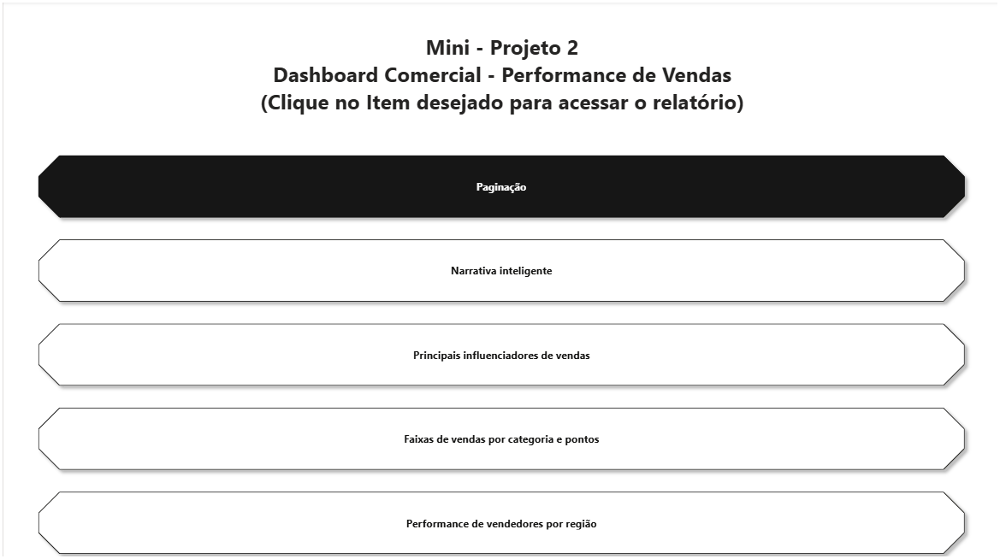
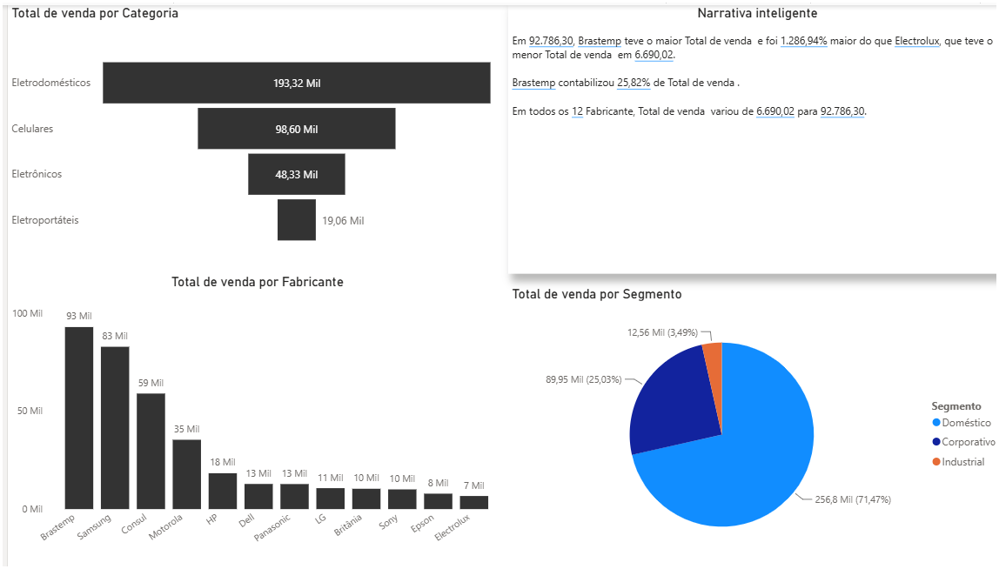
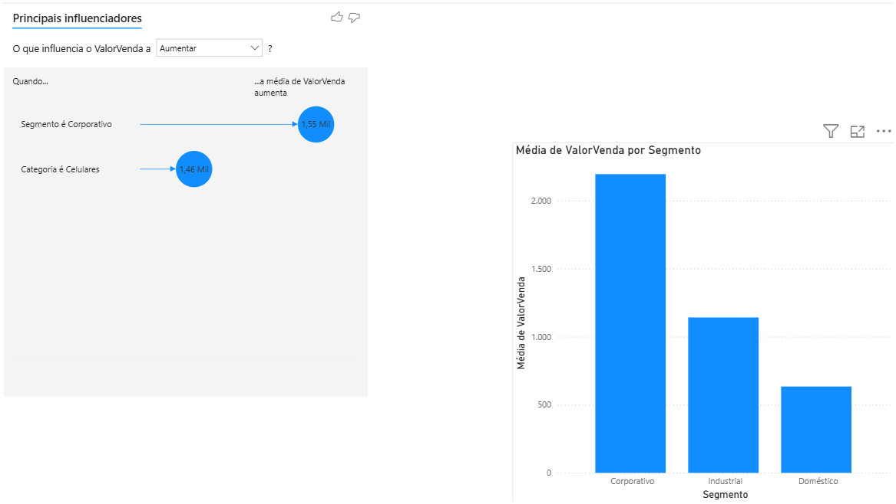
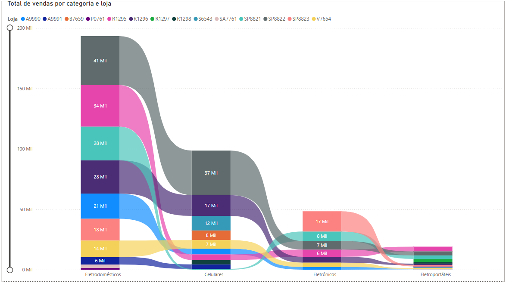
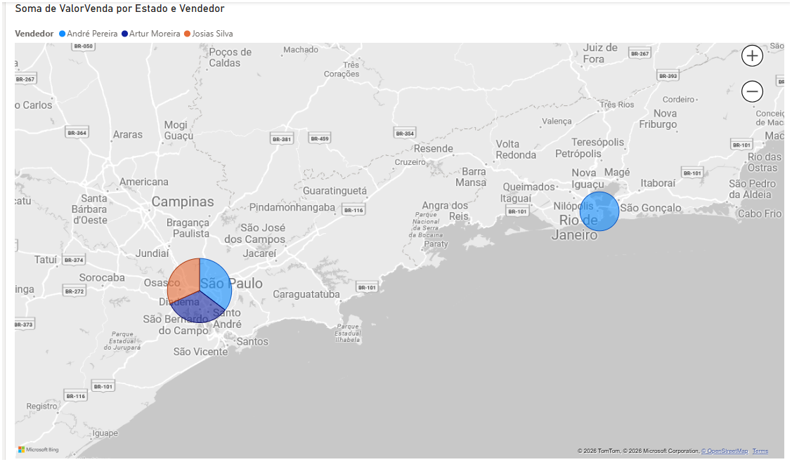

# Dashboard comercial – performance de vendas
# Dashboard comercial – performance de vendas

Relatório em Power BI com 5 páginas que analisa as vendas de uma empresa por
categoria, fabricante, segmento e região, com navegação por botões.

## Perguntas respondidas

- Quais categorias e fabricantes vendem mais?
- Qual segmento de clientes concentra as vendas e qual tem o maior valor por venda?
- O que mais influencia o valor de uma venda?
- Como as vendas se distribuem entre lojas e entre vendedores por região?

## Páginas do relatório

| Página | O que mostra |
|---|---|
| Paginação | Menu com botões para navegar entre as páginas |
| Narrativa inteligente | Resumo automático em texto, funil por categoria, vendas por fabricante e por segmento |
| Principais influenciadores | Fatores que mais aumentam o valor das vendas |
| Faixas de vendas | Vendas por categoria e loja (gráfico ribbon) |
| Performance por região | Mapa com vendas por estado e vendedor |

## Prévia

## Recursos do Power BI usados

Navegador de páginas, segmentações, narrativa inteligente, funil, pizza,
colunas, principais influenciadores, ribbon e mapa.

## Como abrir

1. Baixe o arquivo [dashboard-comercial.pbix](dashboard-comercial.pbix).
2. Abra no **Power BI Desktop** (gratuito, para Windows).

## Autor

Vinicius Costa Braga
[LinkedIn](https://www.linkedin.com/in/viniciuscbraga/)
